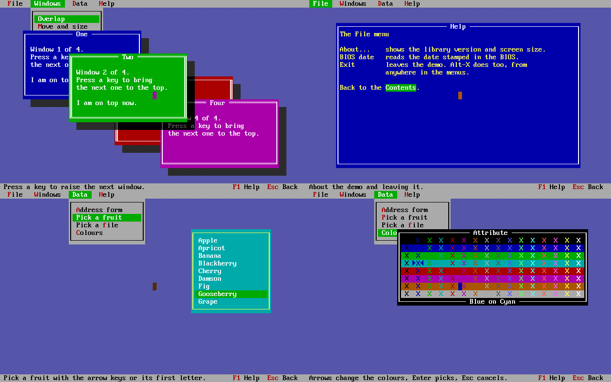

---
hide:
  - navigation
---

# clang-dos SDK

C and C++ for MS-DOS, 16-bit Windows and the rest of the retro family,
with a modern clang. This repository builds the DOS sysroot (picolibc,
compiler-rt and libc++ for every memory model, from tiny `.COM` files to
huge), the DOS graphics and text-mode libraries, and the clang-dos
toolchain packages that bundle every clang-retro target in one download.

```sh
clang --config=dos.cfg -Os hello.c -o hello.exe
clang --config=dos.cfg -mcmodel=tiny hello.c -o hello.com
clang++ --config=dos.cfg -mcmodel=large -Os app.cpp -o app.exe
```

<div class="grid cards" markdown>

-   :material-download: **Get the toolchain**

    ---

    One package for Linux or Windows with clang, lld, JWlink and every
    sysroot. Start with [the toolchain package](toolchain.md), or grab the
    [nightly release](https://github.com/clang-retro/dos-sdk/releases/tag/nightly).

-   :material-memory: **Choose a memory model**

    ---

    Tiny, small, medium, compact, large, huge or huge16:
    [which one fits your program](memory-models.md), and the flags for it.

-   :material-console: **Write for DOS**

    ---

    [Building programs](dos/building.md), [near and far
    pointers](dos/pointers.md), [interrupt handlers](dos/conventions.md)
    and [C++ with libc++](dos/cxx.md).

-   :material-monitor-screenshot: **Full-screen programs**

    ---

    BGI graphics, Fastgraph, conio, curses, a text-mode Windows API, CXL
    and Turbo Vision: [graphics, console and windows](graphics-and-tui.md).

-   :material-microsoft-windows: **Windows, Amiga, Atari, Mac, OS/2**

    ---

    The other platforms have SDKs and sites of their own: see
    [all clang-retro projects](projects.md).

-   :material-hammer-wrench: **Build it yourself**

    ---

    [What you need](dev/requirements.md), [building a
    sysroot](dev/sysroot.md), [the tests](dev/tests.md) and
    [CI and releases](dev/ci.md).

</div>

<figure markdown>
{ width="640" }
<figcaption>The CXL demo program, built with clang-dos, in DOSBox.</figcaption>
</figure>
